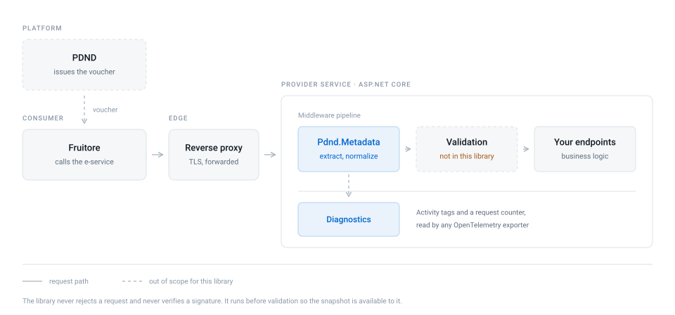
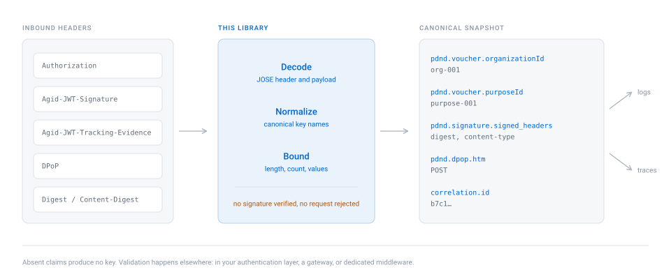
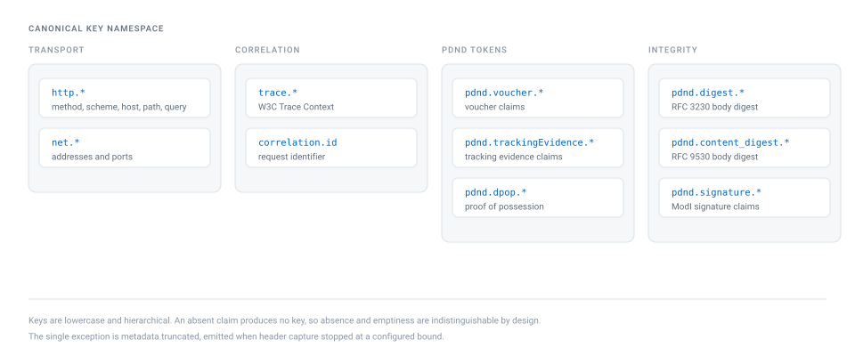
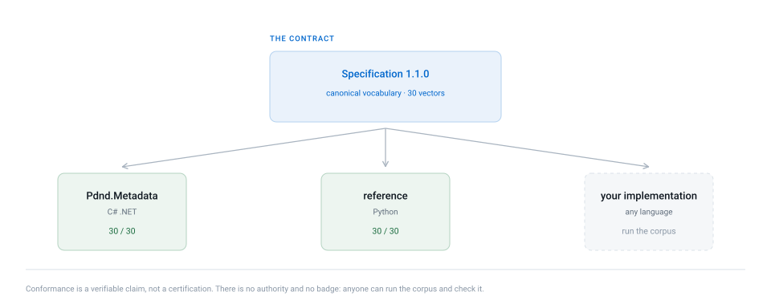

<p align="center">
  <picture>
    <source media="(prefers-color-scheme: dark)" srcset="assets/logo-dark.svg">
    
  </picture>
</p>

<h1 align="center">Pdnd.Metadata</h1>

<p align="center">
  PDND request metadata extraction for .NET services.
</p>

<p align="center">
  <a href="https://opensource.org/licenses/MIT"></a>
  <a href="https://www.nuget.org/packages/Pdnd.Metadata"></a>
  <a href="https://www.nuget.org/packages/Pdnd.Metadata"></a>
  <a href="https://github.com/italia/pdnd-metadata-dotnet/issues"></a>
  <a href="README.md"></a>
</p>

---

A service exposing an e-service on PDND receives requests carrying a voucher, often a tracking
evidence token, a DPoP proof, a body digest, and an integrity signature. Knowing who is calling,
for which purpose, and how to correlate the call means reading and decoding all of those headers.

This library does that once, uniformly, and produces a snapshot with stable key names. The key
vocabulary is defined in a separate specification, so that two services in the same organisation
record the same fact under the same name.

## Where it sits

<p align="center">
  <picture>
    <source media="(prefers-color-scheme: dark)" srcset="assets/diagrams/architecture-dark.svg">
    
  </picture>
</p>

The middleware runs inside the provider service, after the reverse proxy and before validation.
It takes no part in the trust decision, and it never rejects a request.

## In practice

```csharp
var md = accessor.Current;

md.GetFirstValue(PdndMetadataKeys.PdndVoucherOrganizationId);  // "org-001"
md.GetFirstValue(PdndMetadataKeys.PdndVoucherPurposeId);       // "purpose-001"
md.GetFirstValue(PdndMetadataKeys.CorrelationId);              // "b7c1..."
```

## Boundaries

<p align="center">
  <picture>
    <source media="(prefers-color-scheme: dark)" srcset="assets/diagrams/pipeline-dark.svg">
    
  </picture>
</p>

The library extracts and normalizes. It does not verify.

| Does | Does not |
| --- | --- |
| Decode vouchers, tracking evidence, and DPoP proofs | Verify JWS signatures |
| Normalize `Digest` and `Content-Digest` | Compare the digest against the actual body |
| Read `Agid-JWT-Signature` claims | Check signed header correspondence |
| Promote correlation and tracing signals | Detect replay or expiry |
| Bound what is retained | Take any authorization decision |

Vouchers and tokens must be validated in your own authentication layer, in a gateway, or in
dedicated middleware. No security guarantee follows from using this library.

## Packages

| Package | Contents |
| --- | --- |
| `Pdnd.Metadata` | Extraction pipeline, independent of any web framework |
| `Pdnd.Metadata.AspNetCore` | Middleware, DI registration, accessor, Minimal API binding |
| `Pdnd.Metadata.Diagnostics` | Projection onto `Activity` and metrics, consumable by OpenTelemetry |

All three target `net8.0` and `net10.0`.

```bash
dotnet add package Pdnd.Metadata.AspNetCore
```

## Usage

Service registration. The recommended posture captures only what you explicitly govern.

```csharp
builder.Services.AddPdndMetadata(options =>
{
    options.CaptureAllHeaders = false;

    options.HeaderAllowList.Add("traceparent");
    options.HeaderAllowList.Add("x-correlation-id");
    options.HeaderAllowList.Add("x-forwarded-for");

    options.PathExclusions.Add("/health");
    options.PathExclusions.Add("/metrics");
});
```

Middleware, before endpoint mapping.

```csharp
app.UsePdndMetadata();
```

Reading in a controller.

```csharp
[HttpGet("/resource")]
public IActionResult Get([FromServices] IPdndMetadataAccessor accessor)
{
    var md = accessor.Current;

    return Ok(new
    {
        organization = md?.GetFirstValue(PdndMetadataKeys.PdndVoucherOrganizationId),
        purpose = md?.GetFirstValue(PdndMetadataKeys.PdndVoucherPurposeId)
    });
}
```

Reading in a Minimal API, through parameter binding.

```csharp
app.MapGet("/resource", (PdndCallerMetadataParameter pdnd) =>
{
    var md = pdnd.Value;

    return Results.Ok(new
    {
        purpose = md.GetFirstValue(PdndMetadataKeys.PdndVoucherPurposeId),
        dpopMethod = md.GetFirstValue(PdndMetadataKeys.PdndDpopHtm)
    });
});
```

`Snapshot()` returns the whole map. It is a full copy, so call it once and reuse the result rather
than calling it inside a loop.

## Extracted metadata

Keys follow a hierarchical scheme. These are the prefixes.

| Prefix | Source |
| --- | --- |
| `http.*`, `net.*` | Method, scheme, host, path, addresses, and ports |
| `trace.*`, `correlation.id` | W3C Trace Context and request identifiers |
| `pdnd.voucher.*` | Voucher claims, including `purposeId` and `organizationId` |
| `pdnd.trackingEvidence.*` | Tracking evidence token claims |
| `pdnd.dpop.*` | DPoP proof, including `ath` and `nonce` |
| `pdnd.digest.*`, `pdnd.content_digest.*` | Body digest, legacy and RFC 9530 formats |
| `pdnd.signature.*` | `Agid-JWT-Signature` claims, including the signed headers |
| `http.header.*` | Raw headers, when capture is enabled |
| `metadata.truncated` | Present when capture stopped at a configured bound |

<p align="center">
  <picture>
    <source media="(prefers-color-scheme: dark)" srcset="assets/diagrams/keyspace-dark.svg">
    
  </picture>
</p>

The full list, with the source claim for every key, is in
[`spec/PDND_METADATA_SCHEMA.md`](spec/PDND_METADATA_SCHEMA.md).

## Security

Three behaviours are guarantees rather than defaults to be changed inattentively.

**The `Authorization` header is never stored in the clear.** The voucher is decoded and its claims
are extracted, but the token itself appears under no key.

**Header capture is opt-in.** `CaptureAllHeaders` is `false`. Capturing everything retains any
bespoke credential header the deny list does not know about, so enabling it is a deliberate
decision. The deny list remains as a backstop and covers `Authorization`, `Proxy-Authorization`,
`Cookie`, `X-Api-Key`, and other recurring names.

**Signed blobs are not retained.** Tracking evidence, the DPoP proof, and `Agid-JWT-Signature` are
decoded to extract their claims, but the raw token is not stored unless explicitly requested.

Behaviour is fail-soft throughout. A header that is missing, malformed, or oversized is ignored and
the request proceeds. No parsing error turns into a rejected request.

The `Forwarded` and `X-Forwarded-For` headers are trustworthy only when set by a reverse proxy or a
trusted gateway. On open networks the caller controls them, and they are not an identity signal.

## Observability

`Pdnd.Metadata.Diagnostics` projects the snapshot onto the current activity tags and onto a request
counter. It takes no dependency on any OpenTelemetry package: it uses `Activity` and `Meter` from
the base class library, which the SDK consumes once the source names are subscribed.

```csharp
builder.Services.AddOpenTelemetry()
    .WithTracing(t => t.AddSource(PdndInstrumentation.ActivitySourceName))
    .WithMetrics(m => m.AddMeter(PdndInstrumentation.MeterName));

app.UsePdndMetadata();
app.UsePdndDiagnostics();
```

Counter dimensions are limited to three low-cardinality claims. Identifiers such as `jti` remain
trace tags and do not become metric dimensions.

## Specification and conformance vectors

The [`spec/`](spec/) directory holds the canonical key vocabulary and a language-neutral corpus of
conformance vectors. Each vector pairs a set of inbound headers with the keys a conforming
implementation must produce, and with the keys it must not produce.

<p align="center">
  <picture>
    <source media="(prefers-color-scheme: dark)" srcset="assets/diagrams/conformance-dark.svg">
    
  </picture>
</p>

The corpus is executed by this library's test suite and by a second reference implementation in
Python, written from the specification rather than ported from the C#. That implementation is not
published and has no users: it exists to prove the specification is complete, and to find where it
is not.

The `adversarial` group is the most useful part. It covers four-segment tokens, standard Base64
characters where Base64Url is required, invalid UTF-8 that a lenient decoder silently replaces, and
`alg: none`.

## Configuration

| Option | Default | Effect |
| --- | --- | --- |
| `CaptureAllHeaders` | `false` | Capture every header, subject to the deny list |
| `HeaderAllowList` | minimal set | Headers captured when capture is not global |
| `HeaderDenyList` | known credentials | Headers never captured in the clear |
| `MaxHeaderCount` | `64` | Maximum number of distinct headers |
| `MaxHeaderValuesPerName` | `10` | Maximum values per header name |
| `MaxValueLength` | `2048` | Maximum length of a value before truncation |
| `MaxTokenLength` | `16384` | Maximum length of a token to decode |
| `PathExclusions` | empty | Path prefixes for which extraction is skipped |
| `CaptureRaw*` | `false` | Capture raw signed blobs, discouraged in production |

## Compatibility

Version 2.0.0 introduces two breaking changes. `CaptureAllHeaders` now defaults to `false`, and the
`Items` property is replaced by the `Snapshot()` method, kept as obsolete until 3.0.0. Details are
in the [changelog](CHANGELOG.md).

## Official PDND documentation

- [PDND Interoperability guides](https://developer.pagopa.it/pdnd-interoperabilita/guides)
- [Using vouchers](https://developer.pagopa.it/pdnd-interoperabilita/guides/manuale-operativo-pdnd-interoperabilita/riferimenti-tecnici/utilizzare-i-voucher)
- [DPoP reference](https://developer.pagopa.it/pdnd-interoperabilita/guides/manuale-operativo-pdnd-interoperabilita/riferimenti-tecnici/utilizzare-i-voucher/approfondimento-su-dpop)
- [Tracing operating manual](https://developer.pagopa.it/pdnd-interoperabilita/guides/manuale-operativo-tracing)
- [AgID technical interoperability guidelines](https://www.agid.gov.it/it/argomenti/interoperabilita)

## Contributing

Fork, change, commit, open a pull request. Commit messages follow
[Conventional Commits](https://www.conventionalcommits.org/) and are checked in CI.

Conformance vectors are worth more than prose. If you have a token shape from a real integration
that the corpus does not cover, open one with the values replaced by synthetic equivalents. Vectors
documenting a case this implementation handles badly are especially welcome, and are merged as
failing tests before the fix.

## Author and maintainer

| [](https://github.com/engineering87) |
| ------------------------------------------------------------------------------------------------------ |
| **Francesco Del Re** |
| Author & Maintainer |

For any information: francesco.delre[at]protonmail.com.

Report vulnerabilities through the [security policy](SECURITY.md) rather than public issues.

## License

Distributed under the MIT license. See [LICENSE](LICENSE).
