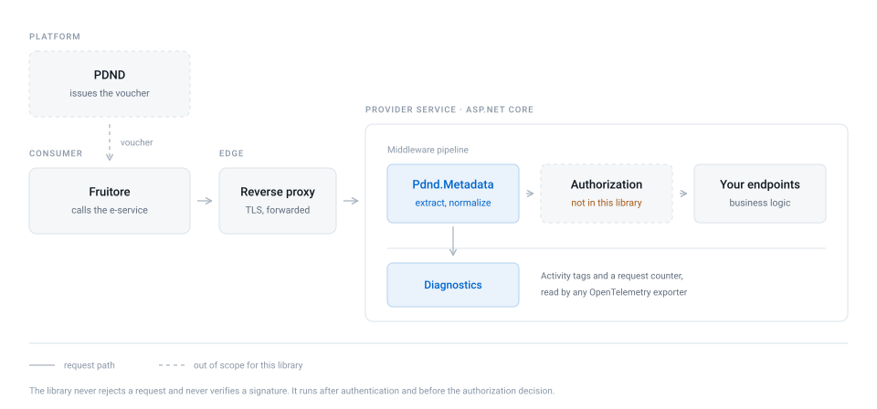
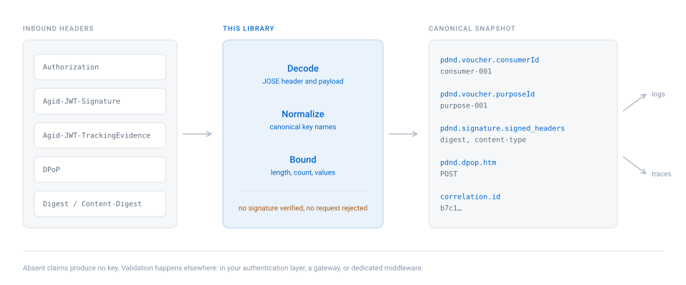
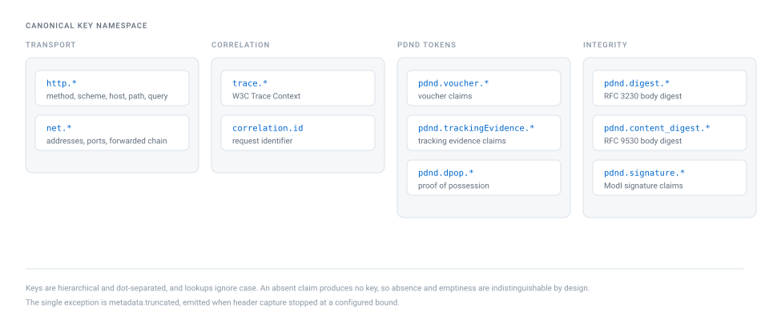
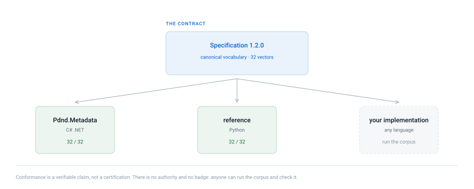

<p align="center">
  <picture>
    <source media="(prefers-color-scheme: dark)" srcset="assets/logo-dark.svg">
    
  </picture>
</p>

<h1 align="center">Pdnd.Metadata</h1>

<p align="center">
  Estrazione dei metadati delle richieste PDND per servizi .NET.
</p>

<p align="center">
  <a href="https://opensource.org/licenses/MIT"></a>
  <a href="https://github.com/italia/pdnd-metadata-dotnet/actions/workflows/ci.yml"></a>
  <a href="https://www.nuget.org/packages/Pdnd.Metadata"></a>
  <a href="https://www.nuget.org/packages/Pdnd.Metadata"></a>
  <a href="https://github.com/italia/pdnd-metadata-dotnet/issues"></a>
  <a href="https://github.com/italia/pdnd-metadata-dotnet/actions/workflows/codeql.yml"></a>
  <a href="https://scorecard.dev/viewer/?uri=github.com/italia/pdnd-metadata-dotnet"></a>
  <a href="README.EN.md"></a>
</p>

---

Un e-service esposto sulla PDND riceve richieste che portano con sé un voucher e, spesso, anche un
token di tracking evidence, una prova DPoP, il digest del corpo e una firma di integrità. Per
sapere chi sta chiamando, per quale finalità e come correlare la chiamata, bisogna leggere e
decodificare tutti questi header.

Questa libreria se ne occupa una volta per tutte, in modo uniforme, e restituisce uno snapshot con
nomi di chiave stabili. Il vocabolario delle chiavi è definito in una specifica a parte, così due
servizi della stessa amministrazione registrano la stessa informazione con lo stesso nome.

## Dove si colloca

<p align="center">
  <picture>
    <source media="(prefers-color-scheme: dark)" srcset="assets/diagrams/architecture-dark.svg">
    
  </picture>
</p>

Il middleware viene eseguito all'interno del servizio erogatore, dopo il reverse proxy e
l'autenticazione, e prima della decisione di autorizzazione. Non prende parte alla decisione di
fiducia e non rifiuta mai una richiesta.

## In breve

```csharp
var md = accessor.Current;

md.GetFirstValue(PdndMetadataKeys.PdndVoucherConsumerId);   // "69e2865e-..." ente fruitore
md.GetFirstValue(PdndMetadataKeys.PdndVoucherPurposeId);    // "1b361d49-..." finalità
md.GetFirstValue(PdndMetadataKeys.PdndVoucherEserviceId);   // "b8c6d7ad-..." e-service
md.GetFirstValue(PdndMetadataKeys.CorrelationId);           // "b7c1..."
```

## Cosa fa e cosa non fa

<p align="center">
  <picture>
    <source media="(prefers-color-scheme: dark)" srcset="assets/diagrams/pipeline-dark.svg">
    
  </picture>
</p>

La libreria estrae e normalizza, ma non verifica nulla.

| Fa | Non fa |
| --- | --- |
| Decodifica il voucher (`Bearer` e `DPoP`), la tracking evidence e la prova DPoP | Verificare le firme JWS |
| Riporta il `cnf.jkt` del voucher e l'`ath` della prova | Verificare il legame tra voucher e prova DPoP |
| Normalizza `Digest` e `Content-Digest` | Confrontare il digest con il corpo ricevuto |
| Legge i claim di `Agid-JWT-Signature` | Controllare che gli header firmati corrispondano |
| Rende disponibili gli identificativi di correlazione e tracing | Rilevare replay o token scaduti |
| Pone un limite a ciò che conserva | Prendere decisioni di autorizzazione |

Voucher e token vanno validati altrove: nel livello di autenticazione dell'applicazione, in un
gateway o in un middleware dedicato. Usare questa libreria non fornisce, di per sé, alcuna
garanzia di sicurezza.

## Pacchetti

| Pacchetto | Contenuto |
| --- | --- |
| `Pdnd.Metadata` | Pipeline di estrazione, indipendente dal framework web |
| `Pdnd.Metadata.AspNetCore` | Middleware, registrazione DI, accessor e binding per le Minimal API |
| `Pdnd.Metadata.Diagnostics` | Esportazione su `Activity` e metriche, compatibile con OpenTelemetry |

Tutti e tre supportano `net8.0` e `net10.0`.

```bash
dotnet add package Pdnd.Metadata.AspNetCore
```

## Utilizzo

Per registrare i servizi bastano poche righe. Le impostazioni predefinite sono già quelle
consigliate: vengono acquisiti solo gli header presenti nell'allow list, che include già tracing,
correlazione, `Forwarded` e `X-Forwarded-For`. Va aggiunto soltanto ciò che serve in più.

```csharp
builder.Services.AddPdndMetadata(options =>
{
    options.HeaderAllowList.Add("X-Ente-Richiedente");   // un header applicativo da conservare

    options.PathExclusions.Add("/health");
    options.PathExclusions.Add("/metrics");
});
```

Il middleware va aggiunto prima della mappatura degli endpoint. L'ordine conta in due casi:

- va inserito dopo `UseAuthentication()`, altrimenti le chiavi `claim.*` restano vuote;
- se è presente `UseForwardedHeaders()`, tieni conto che consuma `X-Forwarded-For` e lo sposta in
  `X-Original-For`: `net.forwarded_for` conterrà quindi solo ciò che rimane.

```csharp
app.UseAuthentication();
app.UsePdndMetadata();
app.UseAuthorization();
```

Lettura da un controller:

```csharp
[HttpGet("/resource")]
public IActionResult Get([FromServices] IPdndMetadataAccessor accessor)
{
    var md = accessor.Current;

    return Ok(new
    {
        consumer = md?.GetFirstValue(PdndMetadataKeys.PdndVoucherConsumerId),
        purpose = md?.GetFirstValue(PdndMetadataKeys.PdndVoucherPurposeId)
    });
}
```

Lettura da una Minimal API, tramite il binding del parametro:

```csharp
app.MapGet("/resource", (PdndCallerMetadataParameter pdnd) =>
{
    var md = pdnd.Value;

    return Results.Ok(new
    {
        purpose = md.GetFirstValue(PdndMetadataKeys.PdndVoucherPurposeId),
        dpopMethod = md.GetFirstValue(PdndMetadataKeys.PdndDpopHtm)
    });
});
```

`Snapshot()` restituisce l'intera mappa sotto forma di copia completa: conviene chiamarlo una volta
sola e riutilizzare il risultato, non invocarlo all'interno di un ciclo.

## Metadati estratti

Le chiavi sono organizzate in modo gerarchico. Questi sono i prefissi principali.

| Prefisso | Origine |
| --- | --- |
| `http.*`, `net.*` | Metodo, schema, host, path, indirizzi, porte e catena forwarded |
| `security.*` | HTTPS, mTLS (solo l'impronta del certificato), protocollo TLS e HTTP |
| `claim.*` | Claim dell'utente autenticato, dopo `UseAuthentication()` |
| `trace.*`, `correlation.id` | W3C Trace Context e identificativi di richiesta |
| `pdnd.voucher.*` | Claim del voucher: `client_id`, `purposeId`, `consumerId`, `producerId`, `eserviceId`, `descriptorId`, `cnf.jkt`, `digest` |
| `pdnd.trackingEvidence.*` | Claim di `Agid-JWT-TrackingEvidence`, compresi i dati di audit `userID`, `userLocation`, `LoA` |
| `pdnd.dpop.*` | Prova DPoP, compresi `htm`, `htu` e `ath` |
| `pdnd.digest.*`, `pdnd.content_digest.*` | Digest del corpo, nel formato legacy e in quello RFC 9530 |
| `pdnd.signature.*` | Claim di `Agid-JWT-Signature`, compresi gli header firmati |
| `http.header.*` | Header originali, quando l'acquisizione è abilitata |
| `metadata.truncated` | Presente quando l'acquisizione si è interrotta per un limite configurato |

<p align="center">
  <picture>
    <source media="(prefers-color-scheme: dark)" srcset="assets/diagrams/keyspace-dark.svg">
    
  </picture>
</p>

L'elenco completo, con il claim da cui proviene ciascuna chiave, si trova in
[`spec/PDND_METADATA_SCHEMA.md`](spec/PDND_METADATA_SCHEMA.md).

I nomi dei claim seguono gli esempi del manuale operativo PDND. I voucher attuali identificano
l'ente fruitore con `consumerId`. La chiave `pdnd.voucher.organizationId` resta disponibile per i
token che la contengono ancora, ma non va usata per identificare il chiamante. Analogamente,
l'header della tracking evidence si chiama `Agid-JWT-TrackingEvidence`: la variante con il
trattino, `Agid-JWT-Tracking-Evidence`, è accettata solo per compatibilità.

## Sicurezza

Tre comportamenti sono garanzie, non impostazioni predefinite da cambiare con leggerezza.

**L'header `Authorization` non viene mai salvato in chiaro.** Il voucher viene decodificato per
estrarne i claim, ma il token non compare in nessuna chiave.

**L'acquisizione degli header va abilitata esplicitamente.** `CaptureAllHeaders` vale `false`.
Acquisire tutti gli header significherebbe conservare anche eventuali credenziali che la deny list
non conosce, per questo abilitarlo dev'essere una scelta consapevole. La deny list resta comunque
come rete di sicurezza e comprende `Authorization`, `Proxy-Authorization`, `Cookie`, `X-Api-Key` e
altri nomi ricorrenti.

**I token firmati non vengono conservati.** Tracking evidence, prova DPoP e `Agid-JWT-Signature`
vengono decodificati per estrarne i claim, ma il token originale viene salvato solo se lo si
richiede esplicitamente.

Ogni passaggio è fail-soft: un header assente, malformato o troppo grande viene ignorato e la
richiesta prosegue. Un errore di parsing non porta mai al rifiuto della richiesta.

Gli header `Forwarded` e `X-Forwarded-For` sono affidabili solo se impostati da un reverse proxy o
da un gateway fidato. Su una rete aperta il chiamante può impostarli a piacere, quindi non vanno
usati per identificarlo.

## Prestazioni e robustezza

La libreria è pensata per essere eseguita a ogni richiesta senza appesantirla e senza mai
diventare un punto di guasto.

- **Non blocca.** Non esegue I/O né chiamate di rete e non resta in attesa di operazioni
  asincrone. L'estrazione è un calcolo in memoria e l'estrattore è un singleton privo di stato
  condiviso.
- **Non manda in errore l'applicazione.** Tutto ciò che la libreria esegue prima del resto della
  pipeline è fail-soft. Un errore di estrazione, una configurazione non valida, un logger o un
  exporter di metriche che si guastano, o un `AddPdndMetadata()` dimenticato: in tutti questi casi
  la richiesta prosegue con uno snapshot vuoto. Le eccezioni sollevate dai tuoi endpoint, invece,
  si propagano normalmente.
- **Ha un costo contenuto e limitato.** Su una richiesta PDND completa (voucher, prova DPoP,
  tracking evidence, firma e digest) l'estrazione richiede qualche decina di microsecondi e circa
  30 KB di memoria. La lunghezza dei valori è limitata da `MaxValueLength`, quella dei token da
  `MaxTokenLength` e il numero di header da `MaxHeaderCount`.
- **Un input malevolo non costa di più.** I token malformati vengono scartati senza sollevare
  eccezioni e costano meno di un token valido, quindi non possono essere usati per aumentare il
  carico. Anche le dimensioni delle metriche hanno un numero massimo di valori distinti.
- **Non costa nulla dove non serve.** Con `PathExclusions` si salta l'estrazione per health check
  e metriche, e ogni decodifica si può disattivare singolarmente.

## Osservabilità

`Pdnd.Metadata.Diagnostics` riporta lo snapshot nei tag dell'attività corrente e in un contatore
di richieste. Non dipende da alcun pacchetto OpenTelemetry: usa `Activity` e `Meter` della libreria
di base, che l'SDK raccoglie una volta registrato il meter.

I tag vengono scritti sull'`Activity` corrente, ovvero quella che ASP.NET Core crea per la
richiesta: per vederli nelle tracce serve quindi la strumentazione ASP.NET Core di OpenTelemetry.
La libreria non crea una propria `ActivitySource`, per cui
`AddSource(PdndInstrumentation.ActivitySourceName)` non serve.

```bash
dotnet add package Pdnd.Metadata.Diagnostics
```

```csharp
builder.Services.AddOpenTelemetry()
    .WithTracing(t => t.AddAspNetCoreInstrumentation())
    .WithMetrics(m => m.AddMeter(PdndInstrumentation.MeterName));

app.UsePdndMetadata();
app.UsePdndDiagnostics();
```

Il contatore `pdnd.requests` ha solo tre dimensioni, scelte tra i claim con pochi valori distinti:
`consumerId` (oppure `organizationId` per i token legacy), `purposeId` e `client_id`.
Identificativi come `jti` restano tag delle tracce e non diventano dimensioni delle metriche.

Questi claim provengono da un voucher non ancora verificato, quindi chiunque può valorizzarli a
piacere. Per questo ogni dimensione registra al massimo `MaxDistinctValuesPerDimension` valori
distinti (`100` per impostazione predefinita); i successivi vengono raggruppati sotto `other`. Le
dimensioni si possono anche disattivare del tutto.

```csharp
builder.Services.AddPdndDiagnostics(o =>
{
    o.MaxDistinctValuesPerDimension = 500;
    // o.IncludeConsumerDimensions = false;
});
```

## Specifica e vettori di conformità

La cartella [`spec/`](spec/) contiene il vocabolario delle chiavi canoniche e una raccolta di
vettori di conformità, in un formato indipendente dal linguaggio. Ogni vettore associa un insieme
di header in ingresso alle chiavi che un'implementazione conforme deve produrre e a quelle che non
deve produrre.

<p align="center">
  <picture>
    <source media="(prefers-color-scheme: dark)" srcset="assets/diagrams/conformance-dark.svg">
    
  </picture>
</p>

I vettori vengono eseguiti sia dalla suite di test di questa libreria sia da una seconda
implementazione di riferimento in Python, scritta a partire dalla specifica e non tradotta dal C#.
Questa seconda implementazione non viene pubblicata e non ha utenti: serve a dimostrare che la
specifica è completa e a scoprire dove non lo è.

Il gruppo `adversarial` è la parte più preziosa. Comprende token a quattro segmenti, caratteri
Base64 standard dove è richiesto il Base64Url, sequenze UTF-8 non valide che un decoder permissivo
sostituirebbe senza segnalarlo e token con `alg: none`.

## Configurazione

| Opzione | Predefinito | Effetto |
| --- | --- | --- |
| `CaptureAllHeaders` | `false` | Acquisisce tutti gli header, esclusi quelli della deny list |
| `HeaderAllowList` | insieme minimo | Header acquisiti quando `CaptureAllHeaders` è disattivato |
| `HeaderDenyList` | credenziali note | Header che non vengono mai salvati in chiaro |
| `MaxHeaderCount` | `64` | Numero massimo di header distinti |
| `MaxHeaderValuesPerName` | `10` | Numero massimo di valori per lo stesso header |
| `MaxValueLength` | `2048` | Lunghezza massima di un valore; oltre, il valore viene troncato |
| `MaxTokenLength` | `16384` | Lunghezza massima di un token da decodificare |
| `PathExclusions` | vuoto | Path esclusi dall'estrazione, confrontati per segmento: `/health` non esclude `/healthcare` |
| `CaptureRawTrackingEvidenceHeader`, `CaptureRawDpopHeader`, `CaptureRawSignatureHeader` | `false` | Conserva i token firmati originali; sconsigliato in produzione |
| `CaptureRawDigestHeader` | `true` | Conserva `Digest` e `Content-Digest` originali, che non sono credenziali |
| `Parse*`, `PromoteTracingHeaders`, `NormalizeForwardedHeaders` | `true` | Ogni decodifica si può disattivare singolarmente, senza effetti sulle altre |

Le opzioni di `Pdnd.Metadata.Diagnostics` si registrano con `AddPdndDiagnostics()`.

| Opzione | Predefinito | Effetto |
| --- | --- | --- |
| `IncludeConsumerDimensions` | `true` | Suddivide il contatore per ente fruitore, finalità e client |
| `MaxDistinctValuesPerDimension` | `100` | Valori distinti per dimensione; i successivi diventano `other` |

## Compatibilità

La versione 2.0.0 ha introdotto due modifiche non compatibili: `CaptureAllHeaders` vale ora `false`
e la proprietà `Items` è stata sostituita dal metodo `Snapshot()`. `Items` resta disponibile, come
obsoleta, fino alla 3.0.0.

Con la versione 2.1.0 la dimensione del contatore `pdnd.requests` che identifica l'ente fruitore si
chiama `pdnd.voucher.consumerId` anziché `pdnd.voucher.organizationId`. I voucher PDND attuali non
contengono `organizationId`, quindi la vecchia dimensione valeva sempre `unknown`. Eventuali
dashboard che la utilizzano vanno aggiornate. I dettagli sono nel [changelog](CHANGELOG.md).

## Documentazione ufficiale PDND

- [Guide PDND Interoperabilità](https://developer.pagopa.it/pdnd-interoperabilita/guides)
- [Utilizzo dei voucher](https://developer.pagopa.it/pdnd-interoperabilita/guides/manuale-operativo-pdnd-interoperabilita/riferimenti-tecnici/utilizzare-i-voucher)
- [Approfondimento su DPoP](https://developer.pagopa.it/pdnd-interoperabilita/guides/manuale-operativo-pdnd-interoperabilita/riferimenti-tecnici/utilizzare-i-voucher/approfondimento-su-dpop)
- [Verificare un voucher DPoP (erogatore)](https://developer.pagopa.it/it/pdnd-interoperabilita/guides/manuale-operativo-pdnd-interoperabilita/v1.0/tutorial/tutorial-per-lerogatore/come-verificare-la-validita-di-un-voucher-dpop)
- [Voucher con informazioni aggiuntive (AUDIT_REST_02)](https://developer.pagopa.it/it/pdnd-interoperabilita/guides/manuale-operativo-pdnd-interoperabilita/v1.0/tutorial/tutorial-per-il-fruitore/come-richiedere-un-voucher-bearer-per-le-api-di-un-erogatore-con-informazioni-aggiuntive)
- [Manuale operativo tracing](https://developer.pagopa.it/pdnd-interoperabilita/guides/manuale-operativo-tracing)
- [Linee Guida AgID sull'interoperabilità tecnica](https://www.agid.gov.it/it/argomenti/interoperabilita)

## Contribuire

Il flusso è quello consueto: fork, modifiche, commit e pull request. I messaggi di commit seguono
le [Conventional Commits](https://www.conventionalcommits.org/) e vengono controllati in CI.

```bash
dotnet test --solution Pdnd.Metadata.slnx
```

I vettori di conformità sono più utili di qualsiasi descrizione. Se hai un token proveniente da
un'integrazione reale con una forma che la raccolta non copre ancora, proponi un nuovo vettore
sostituendo i valori con dati fittizi. Sono particolarmente graditi i vettori che mettono in luce
un caso gestito male da questa implementazione: vengono accolti come test che falliscono, in attesa
della correzione.

## Autore e maintainer

| [](https://github.com/engineering87) |
| ------------------------------------------------------------------------------------------------------ |
| **Francesco Del Re** |
| Autore e maintainer |

Per qualsiasi informazione: francesco.delre[at]protonmail.com.

Le vulnerabilità vanno segnalate seguendo la [security policy](SECURITY.md), non aprendo issue
pubbliche.

## Licenza

Distribuito con licenza MIT. Vedi [LICENSE](LICENSE).
